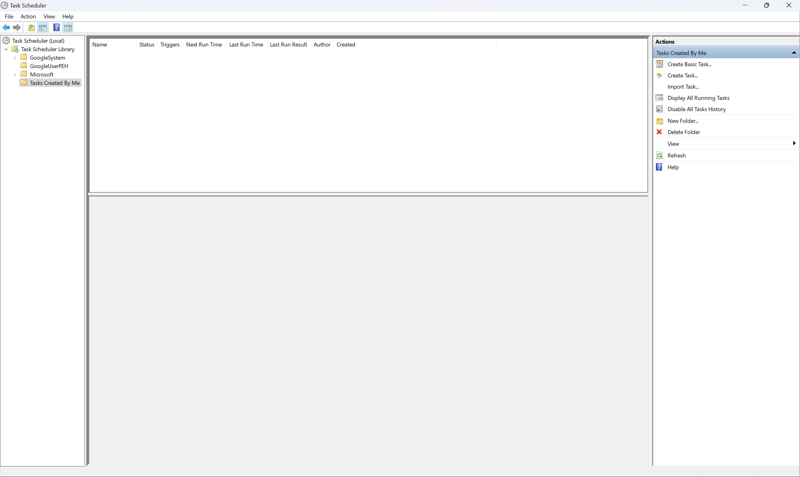
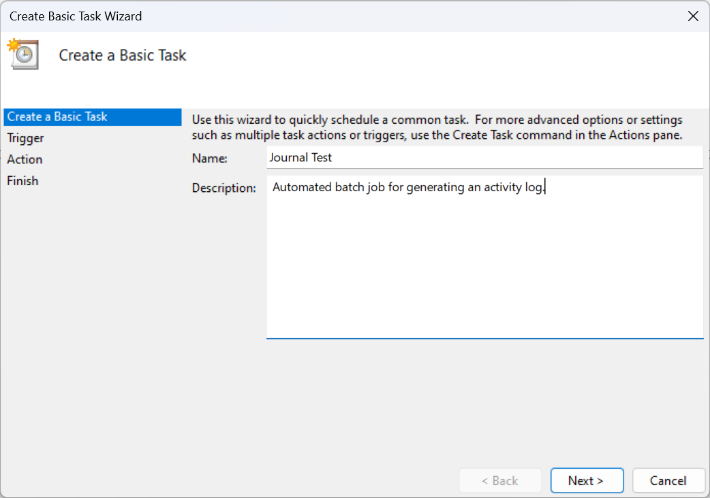
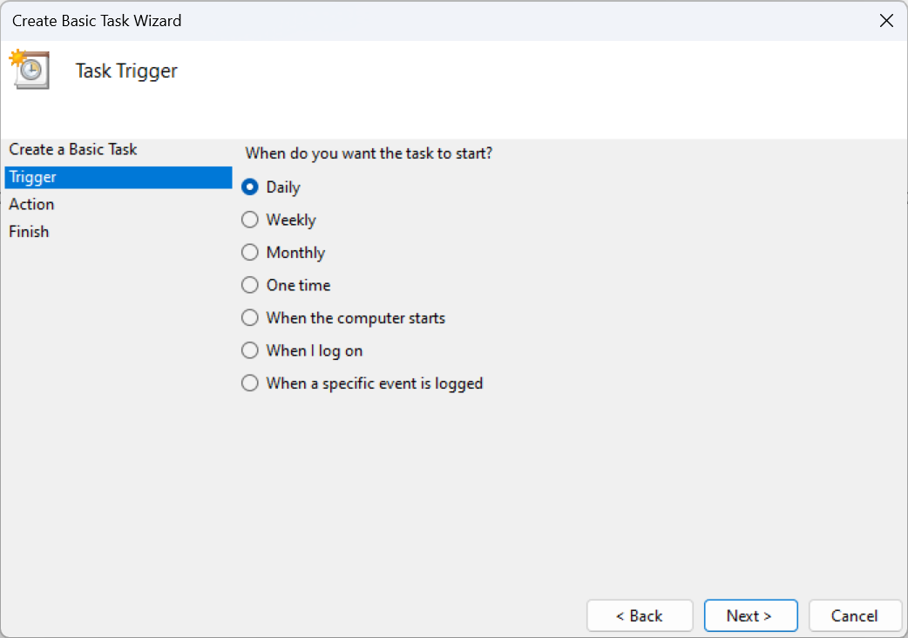
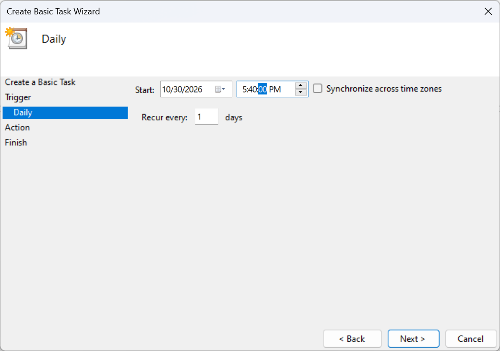
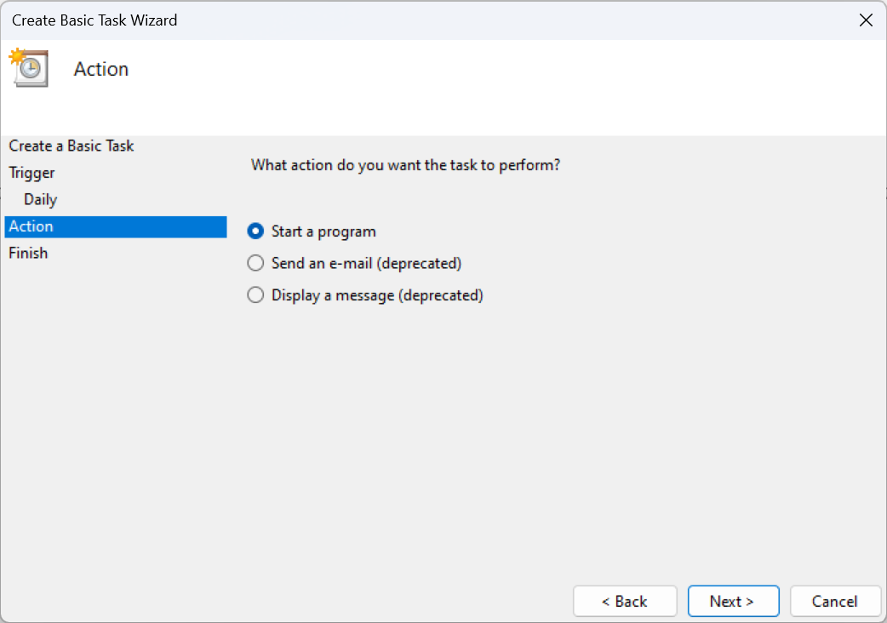
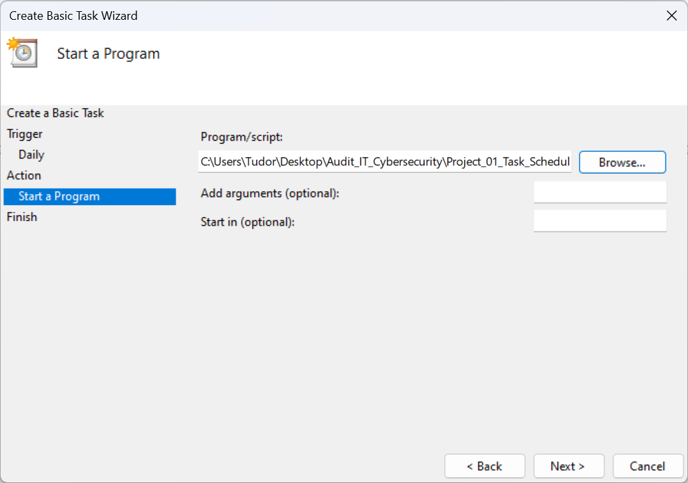
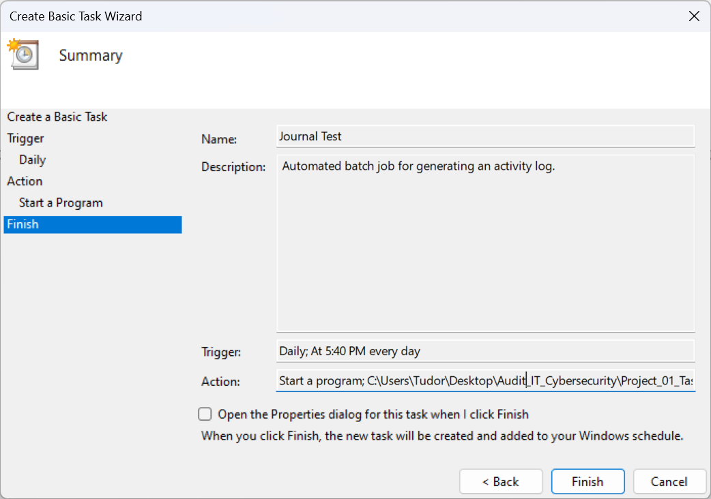
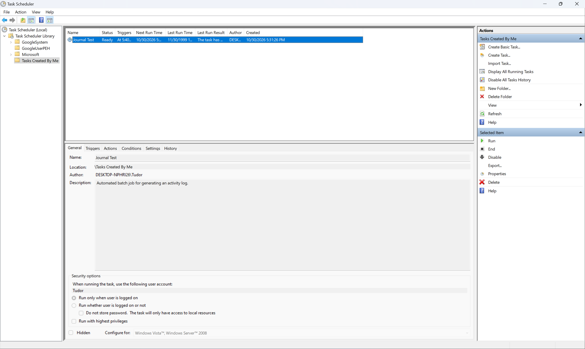
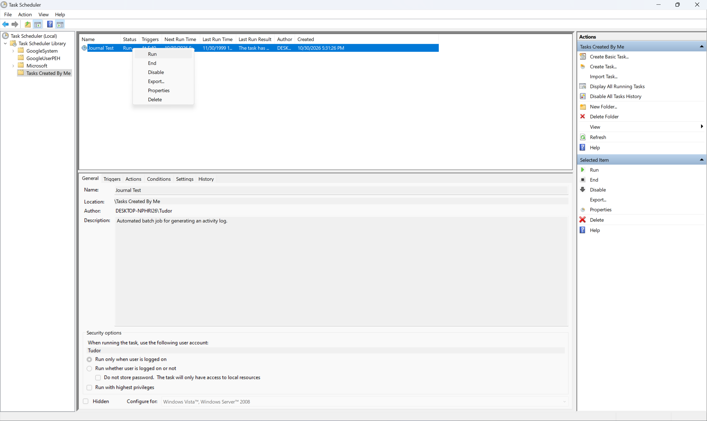
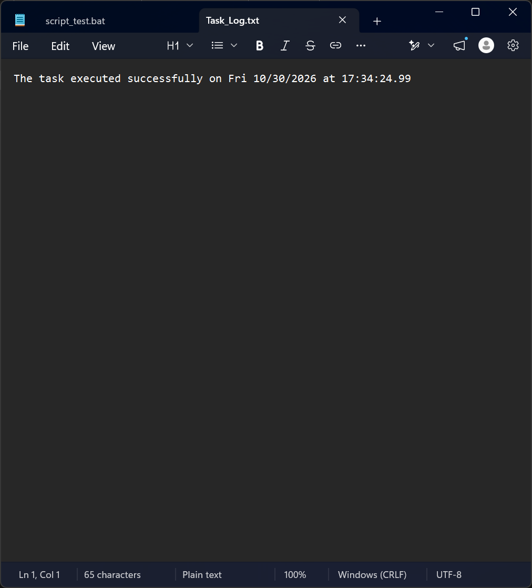

# Windows Task Scheduler: Automation and Logging Walkthrough

This project demonstrates the configuration and execution of a scheduled batch job within a Windows environment. From an IT Audit and Cybersecurity perspective, understanding automated background tasks is essential for verifying backup procedures, evaluating system logging mechanisms, and auditing privilege management.

## Objective

To create a batch script (`script_test.bat`) and schedule it via Windows Task Scheduler for recurring execution, generating an unalterable activity log (`Task_Log.txt`) with accurate system timestamps.

## Batch Script Implementation

The following script retrieves the current system date and time and appends the output to a designated log file:

```cmd
@echo off
echo The task executed successfully on %date% at %time% >> "%USERPROFILE%\Desktop\Audit_IT_Cybersecurity\Project_01_Task_Scheduler_Automation\Task_Log.txt"
```

---

## Configuration Walkthrough

### Step 1: Organizing the Task Scheduler Library
To maintain separation between default operating system tasks and custom administrative scripts, a dedicated folder named `Tasks Created By Me` was created under the Task Scheduler Library.



### Step 2: Defining Task Identity
Using the **Create Basic Task Wizard**, the job was assigned a clear identifier (`Journal Test`) and a description outlining its purpose (`Automated batch job for generating an activity log.`). Clear documentation of scheduled jobs is a standard requirement in IT system audits.



### Step 3: Selecting the Trigger Type
The trigger frequency was set to **Daily** to simulate a recurring operational control or daily maintenance routine.



### Step 4: Configuring the Execution Schedule
The start date and exact execution time (`5:40:00 PM`) were configured, set to recur every 1 day.



### Step 5: Selecting the Task Action
The action type was set to **Start a program**, allowing the operating system to invoke the command interpreter and run the custom batch script.



### Step 6: Linking the Batch Script
The exact file path to the `script_test.bat` executable was provided in the **Program/script** field. In a production environment, scripts should be stored in restricted directories to prevent unauthorized modification.



### Step 7: Configuration Summary and Verification
Before finalizing the task, the summary screen was reviewed to verify that the Name, Description, Trigger, and Action parameters align with the intended design.



### Step 8: Reviewing Security Context and Privileges
Once created, the task appears in the library with a `Ready` status. Reviewing the **General** tab confirms the security context:
* **User Account:** Runs under the standard user profile (`Tudor`).
* **Execution Context:** Configured to *Run only when user is logged on*.
* **Least Privilege Principle:** The option *Run with highest privileges* is left unchecked, ensuring the script does not execute with unnecessary administrative rights.



### Step 9: On-Demand Testing (Manual Execution)
To validate the control design without waiting for the scheduled trigger, the task was executed manually by right-clicking the job entry and selecting **Run**.



### Step 10: Audit Evidence Verification
Following execution, the output artifact (`Task_Log.txt`) was generated in the target directory. Opening the file confirms that the batch job ran as designed, recording the exact date and timestamp (`Fri 10/30/2026 at 17:34:24.99`) as technical evidence.



---

## Key Audit Takeaways

1. **Traceability:** The generated log file provides verifiable proof of execution and timing.
2. **Least Privilege:** The task executes under a standard user context without elevated privileges, minimizing security risks if the script were to be compromised.
3. **Path Integrity:** The action points directly to a known script location, which should be monitored for unauthorized changes in a production environment.