# Nessus Vulnerability Assessment: Uncredentialed vs. Credentialed Scanning Walkthrough

This project demonstrates the end-to-end configuration and execution of vulnerability assessments using **Tenable Nessus** against an isolated Windows 11 virtual machine in **Oracle VirtualBox**. From an IT Audit and Cybersecurity perspective, understanding both uncredentialed (external/black-box) and credentialed (internal/authenticated) scanning is essential for evaluating attack surface visibility, identifying missing security patches, and validating system hardening controls.

## Objective

To deploy an isolated Windows 11 target environment, execute an initial uncredentialed network scan, configure the necessary Windows host settings for authenticated auditing, and perform a comparative analysis between **uncredentialed** and **credentialed** Nessus vulnerability scan results.

## Lab Architecture

* **Scanner (Host):** Tenable Nessus Essentials Plus running locally (`https://localhost:8834`).
* **Target (Guest VM):** Windows 11 Home 64-bit (`Windows11Nessus`) hosted in Oracle VirtualBox.
* **Network Isolation:** VirtualBox **Host-Only Adapter** (`192.168.56.0/24`), ensuring direct scanner-to-target communication without exposing the intentionally weakened test VM to external networks.

---

## Configuration & Execution Walkthrough

### Phase 1: Target Environment Setup

#### Step 1: Creating the Windows 11 Virtual Machine
A dedicated virtual machine named `Windows11Nessus` was provisioned in Oracle VirtualBox using a Windows 11 64-bit ISO image (`Windows11_Client_x64_en-us_26300_9457.iso`). Isolating the target in a virtualized lab environment prevents unintended impact on production or personal systems.

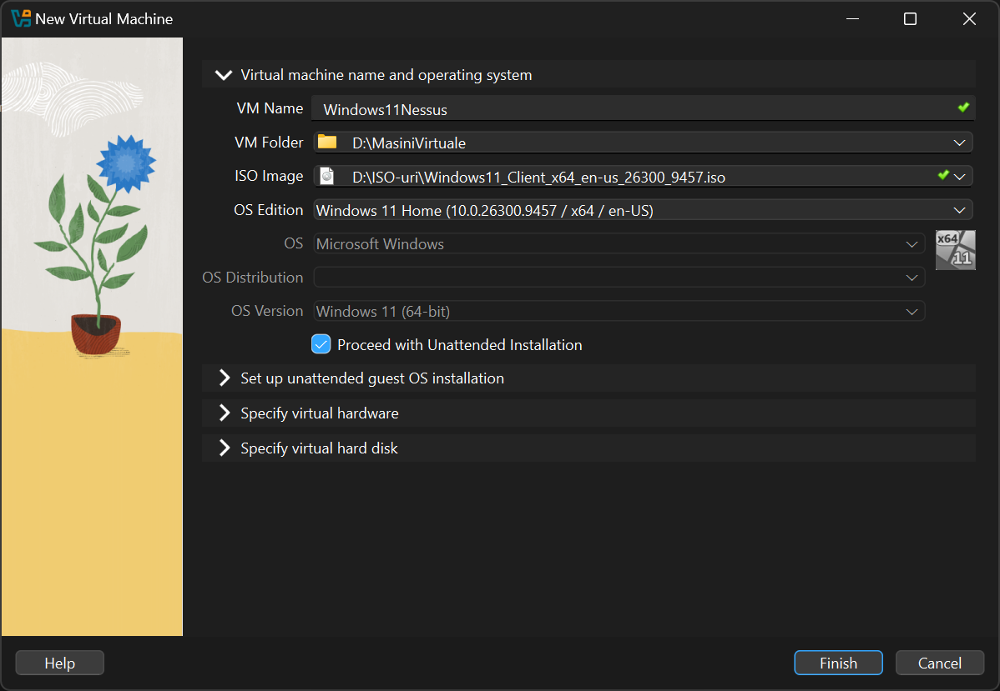

#### Step 2: Configuring Network Isolation (Host-Only Adapter)
Under the VM's **Network** settings (Adapter 1), the network attachment mode was changed from `NAT` to **Host-only Adapter** (`VirtualBox Host-Only Ethernet Adapter`). This establishes a private, bidirectional communication channel between the host running Nessus and the Windows 11 guest VM while keeping the target completely isolated from the internet.

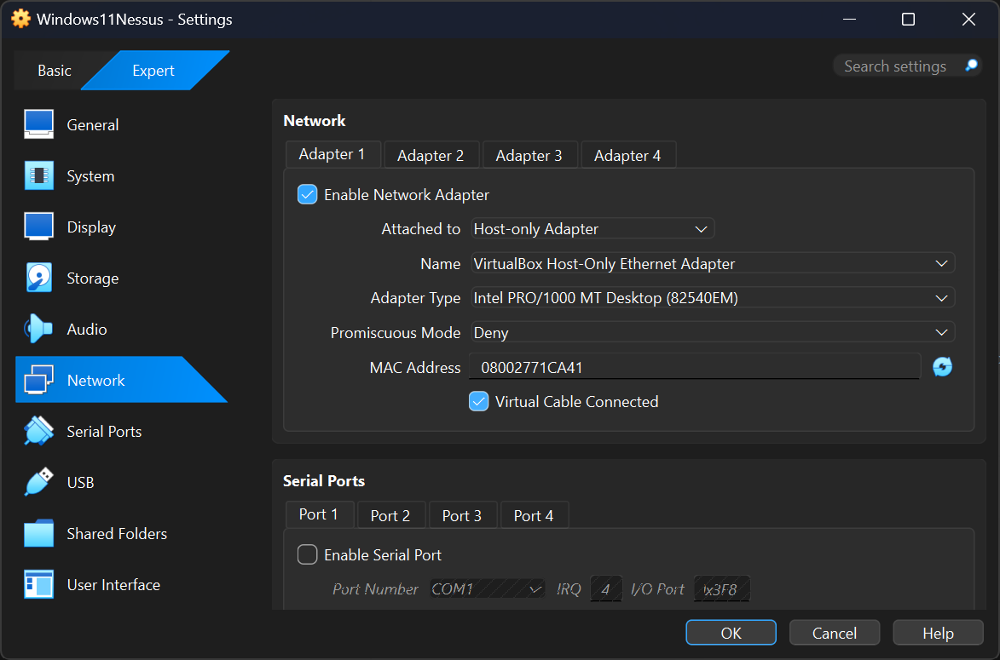

#### Step 3: Identifying the Target IP Address
Inside the Windows 11 VM, `ipconfig` was executed via Command Prompt to verify network connectivity and identify the target's IPv4 address (`192.168.56.101`, subnet mask `255.255.255.0`).

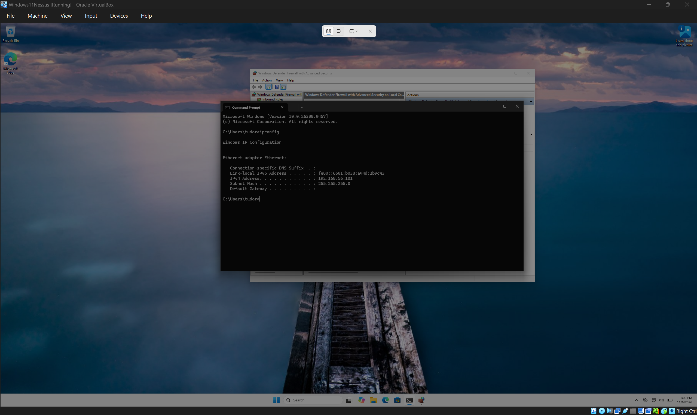

#### Step 4: Disabling Windows Defender Firewall (Lab Testing)
To allow unrestricted port discovery and service enumeration during the baseline test, **Windows Defender Firewall** was disabled across all profiles (*Domain*, *Private*, and *Public*) via *Windows Defender Firewall with Advanced Security*.
> **Audit Note:** Disabling host firewalls is strictly limited to isolated lab testing to simulate an unobstructed network path; in production environments, targeted firewall exceptions for the scanner IP should be used instead.

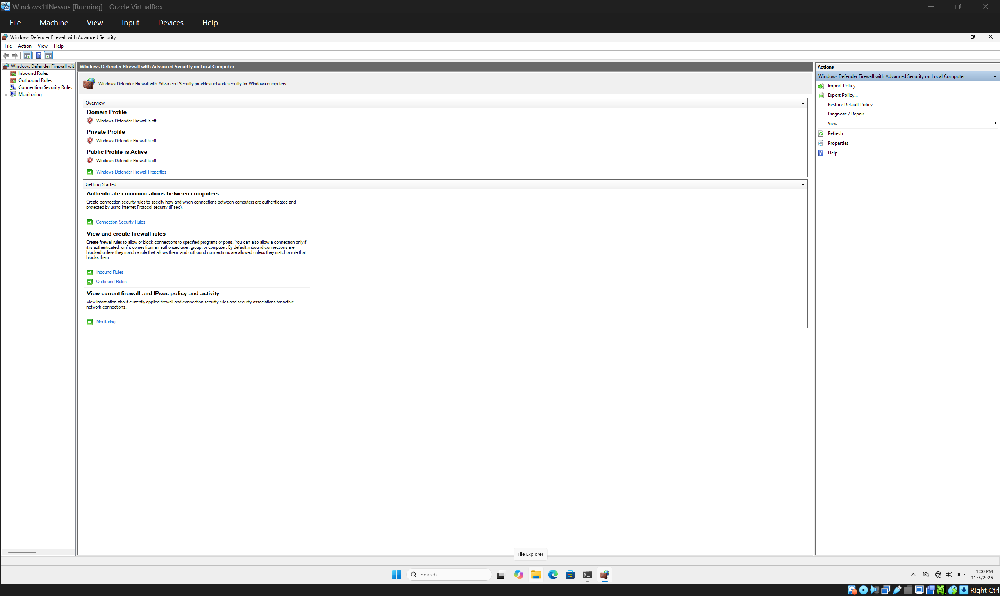

---

### Phase 2: Uncredentialed Vulnerability Scan

#### Step 5: Selecting the Scan Template
Within the Nessus web interface, the **Basic Network Scan** template was selected under the *Vulnerabilities* category. This policy performs a comprehensive network-level assessment suitable for general host auditing.

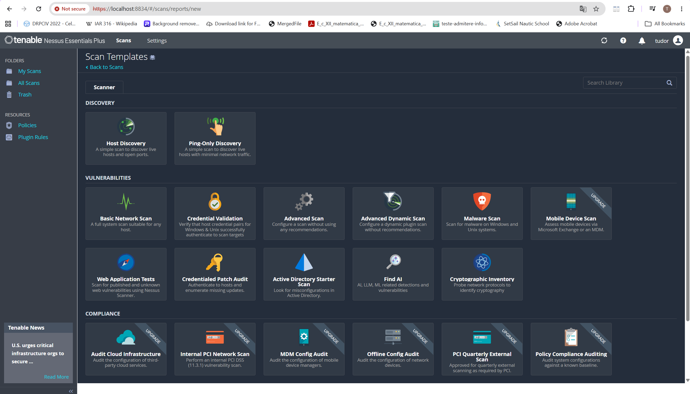

#### Step 6: Configuring the Uncredentialed Scan
A new scan named `Windows 11 Single Host` (Description: `Test Scan`) was configured under the `My Scans` folder, targeting the VM's IP address (`192.168.56.101`). No host authentication credentials were supplied for this initial baseline run.

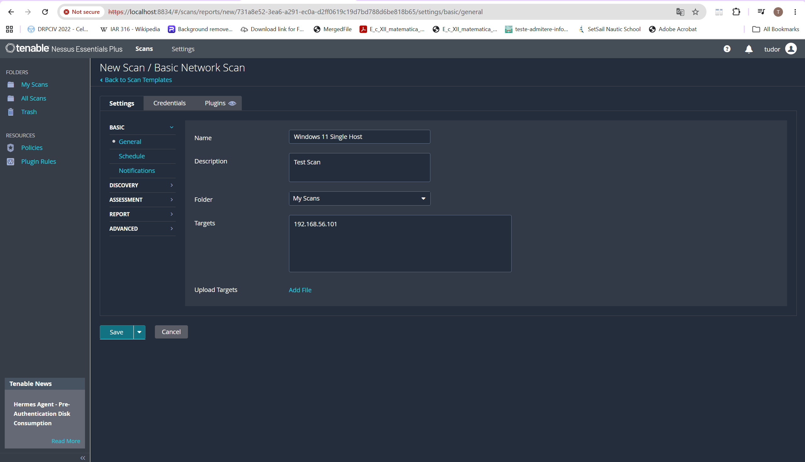

---

### Phase 3: Preparing the Target for Credentialed Scanning

To allow Nessus to perform deep, authenticated local checks (such as enumerating installed software, registry keys, and missing OS patches via SMB/WMI), specific administrative prerequisites were enabled on the Windows 11 VM.

#### Step 7: Enabling the Remote Registry Service
Using the Windows Services console (`services.msc`), the **Remote Registry** service (`RemoteRegistry`) was configured with a Startup type of **Automatic** and started (`Running`). This enables Nessus to query local registry hives remotely during authenticated checks.

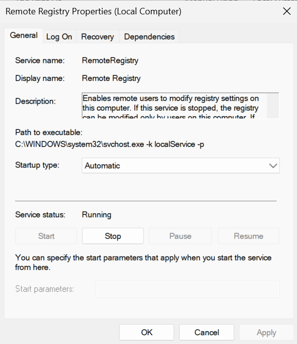

#### Step 8: Enabling Network Discovery and File Sharing
In Windows 11 **Settings > Network & internet > Advanced network settings > Advanced sharing settings**, both **Network discovery** and **File and printer sharing** were turned **On** for the active network profile (*Public networks*). This allows Nessus to connect to administrative SMB shares (e.g., `IPC$`, `ADMIN$`).

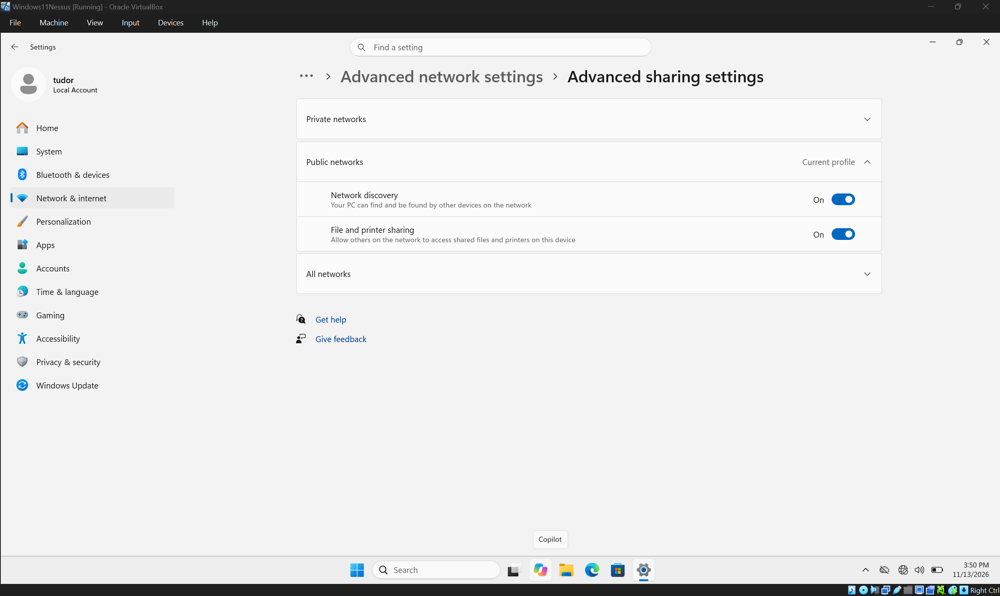

#### Step 9: Adjusting User Account Control (UAC) Settings
For lab testing purposes, **User Account Control (UAC)** was set to **Never notify** to prevent interactive elevation prompts from interfering with remote administrative access.

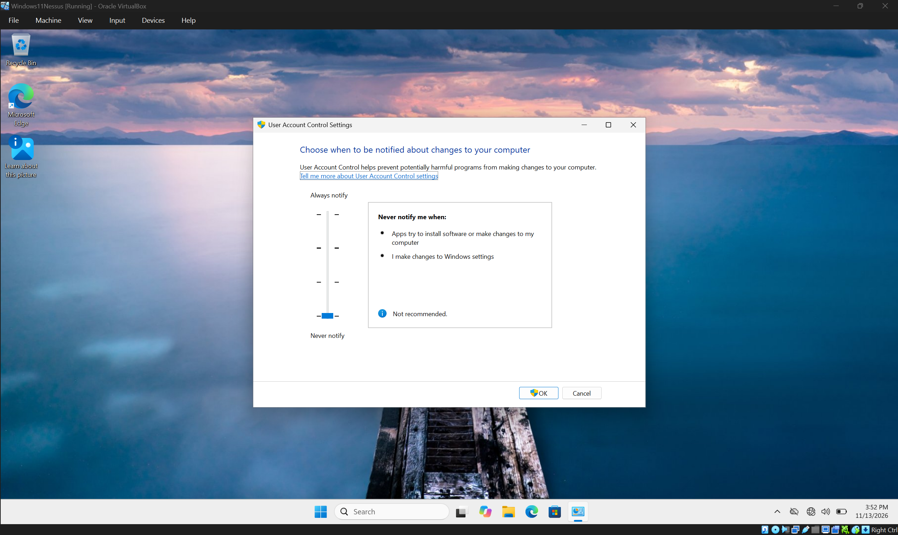

#### Step 10: Disabling UAC Remote Restrictions via Registry
Because Windows restricts local administrator accounts from authenticating remotely over SMB by default, a new `REG_DWORD` value named `LocalAccountTokenFilterPolicy` was created and set to `1` (`0x00000001`) under:

```text
HKEY_LOCAL_MACHINE\SOFTWARE\Microsoft\Windows\CurrentVersion\Policies\System
```

This allows the local administrative account used by Nessus to obtain a full administrative token during the credentialed scan.

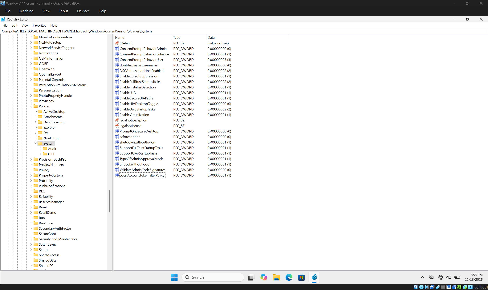

---

### Phase 4: Credentialed Scan Configuration

#### Step 11: Configuring Windows Authentication in Nessus
A second scan (`Windows 11 Single Host With Credentials`) was configured targeting `192.168.56.101`. Under the **Credentials > Host > Windows** tab, Password-based authentication was added using the local account credentials, while retaining secure global defaults (**Never send credentials in the clear** and **Do not use NTLMv1 authentication**).

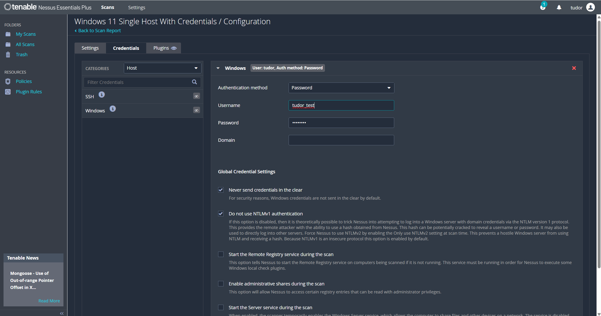

---

### Phase 5: Comparative Analysis (Credentialed vs. Uncredentialed)

#### Step 12: Credentialed Scan Results
The authenticated scan (`Windows 11 Single Host With Credentials`) completed in **31 minutes** with an authentication status of **`Pass`**. Because Nessus could inspect the operating system internals, registry, and installed packages, it uncovered **51 distinct vulnerability entries** (including **Critical**, **15 High**, **Medium**, and **Low** severity findings, alongside **167 Informational** plugins) and generated **10 prioritized remediations**.

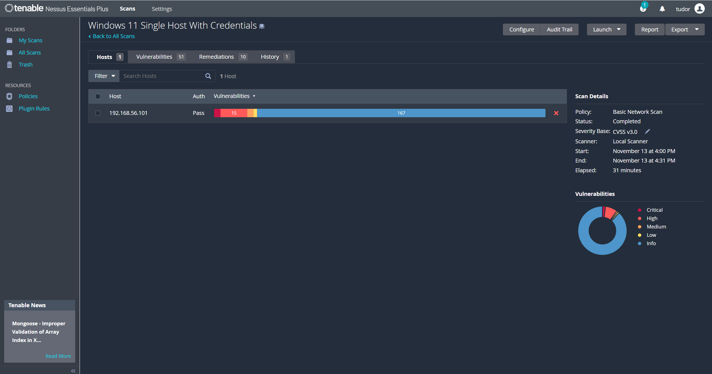

#### Step 13: Uncredentialed Scan Results
In contrast, the unauthenticated scan (`Windows 11 Single Host`) completed in **8 minutes** with an authentication status of **`Fail`**. Restricted strictly to externally visible network ports and banners, it identified only **18 vulnerability entries** (just **1 Medium** finding and **32 Informational** plugins), completely missing all Critical and High local/patch-level vulnerabilities.

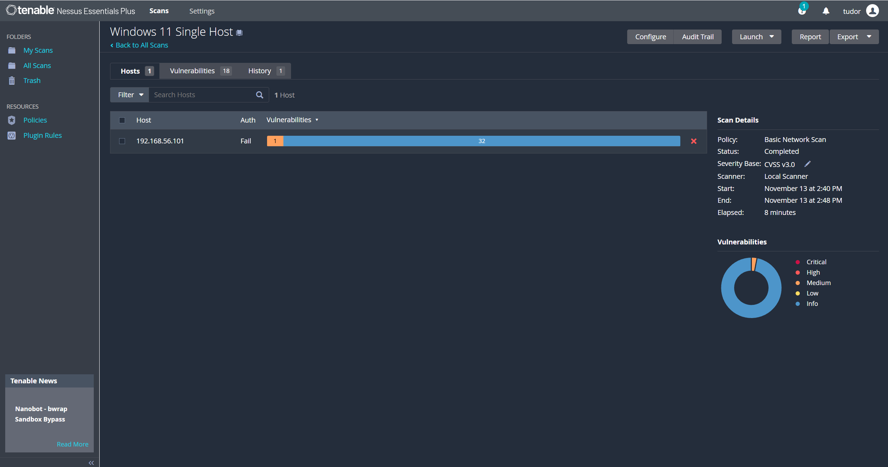

#### Summary Comparison

| Metric | Uncredentialed Scan | Credentialed Scan |
| :--- | :--- | :--- |
| **Authentication Status** | `Fail` (Unauthenticated) | `Pass` (Authenticated) |
| **Scan Duration** | 8 minutes | 31 minutes |
| **Visibility Scope** | External network ports & banners only | OS patch level, registry, installed software, local configs |
| **Critical / High Findings** | 0 | Critical + 15 High |
| **Medium / Low Findings** | 1 Medium | Multiple Medium & Low |
| **Informational Findings** | 32 | 167 |
| **Actionable Remediations** | Minimal | 10 prioritized remediations |

---

## Key Audit Takeaways

1. **Visibility Gap in Uncredentialed Scans:** Relying solely on uncredentialed network scans creates a false sense of security. While the unauthenticated scan reported zero Critical or High vulnerabilities, the authenticated scan revealed 15+ High/Critical exposures hidden beneath the network perimeter.
2. **Defense in Depth & Lab Hardening:** Enabling `RemoteRegistry`, disabling UAC remote restrictions (`LocalAccountTokenFilterPolicy = 1`), and turning off the host firewall significantly lowers system security. In enterprise environments, credentialed scanning should be performed using dedicated, least-privilege service accounts (e.g., via Active Directory GPO) rather than disabling core host protections.
3. **Network Isolation for Safe Testing:** Using a VirtualBox **Host-Only Adapter** effectively contained the intentionally weakened test environment, allowing accurate vulnerability assessment without exposing the virtual machine to external threats.
4. **Prioritized Remediation:** Authenticated scans provide concrete remediation guidance (such as specific missing Windows KBs and outdated third-party software), enabling IT and security teams to efficiently reduce organizational risk.